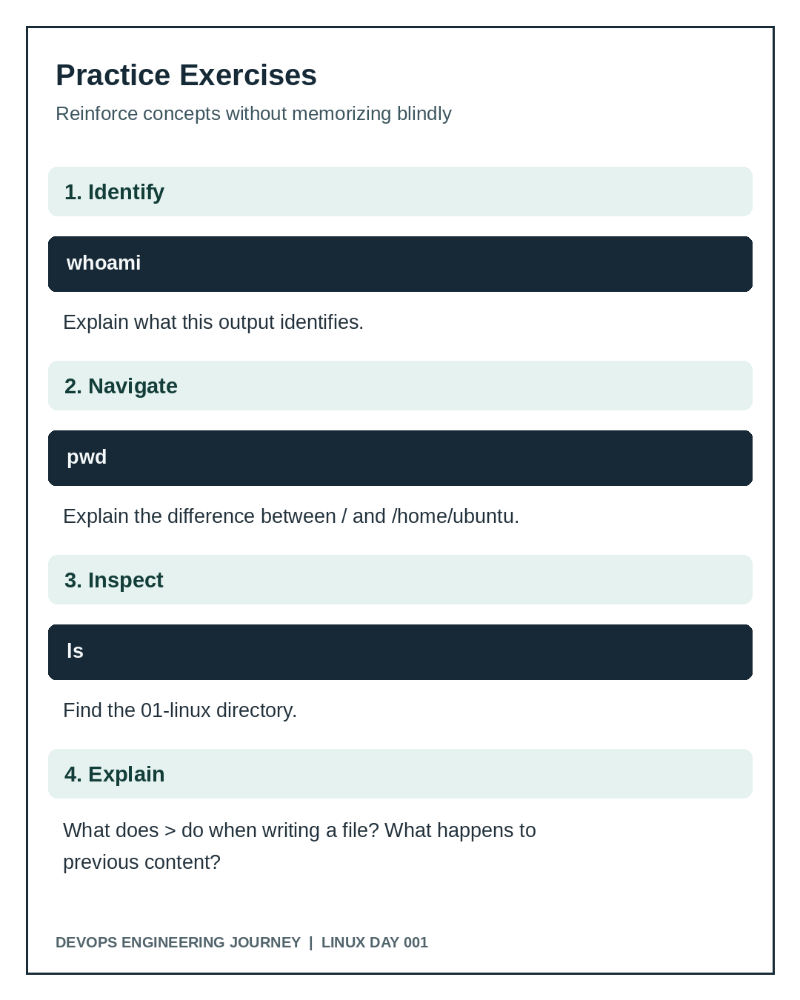

# Day 001 Exercises and Knowledge Check

## Guided practice
1. Run `pwd` from your home directory and explain the output.
2. Run `ls /` and name four important system directories.
3. Explain why `cat /etc/os-release` is safe to use for inspection.
4. Explain what `~` represents.
5. Explain the difference between an absolute path and a relative path.

## Independent questions
1. What is the difference between `mkdir` and `touch`?
2. What happens if you use `>` on a file containing important text?
3. How can you verify that a directory was created?
4. What is the difference between `/` and `/root`?
5. Why should you avoid running package installations on production systems without approval?

## Recorded assessment
The learner answered: `mkdir` creates directories, while `touch` can create empty files. **Correct.** Note that `touch` can also update timestamps of existing files.

## Further practice, not yet assessed
Without copying from the lab, create `scratch`, create an empty `check.txt` inside it, and verify it exists. Do not claim this extension as completed until independently verified.
