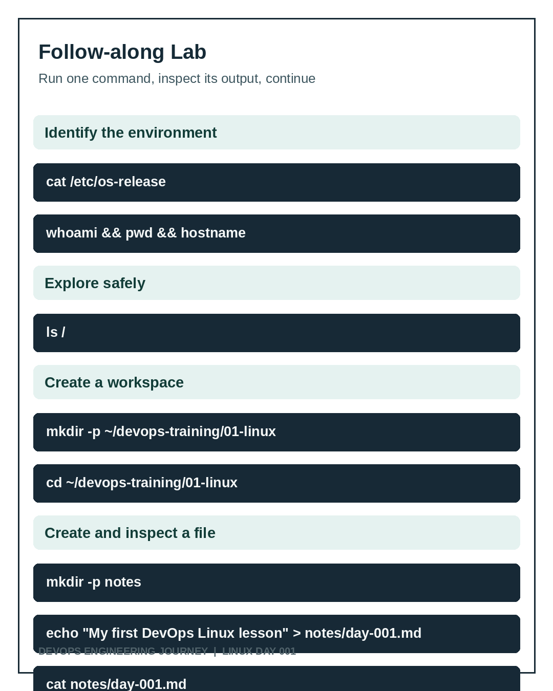

# Lab 001: Identify and Prepare a Linux Workspace



## Prerequisites
- A Linux shell on an instance you are authorized to use.
- This lesson was verified on Ubuntu 26.04 LTS, EC2.
- No administrator privileges required for the core lab.

## Step 1: Identify the operating system
```bash
cat /etc/os-release
```
Expected: fields including `PRETTY_NAME`, `NAME`, `VERSION_ID`. The observed environment identified Ubuntu 26.04 LTS. If the file is absent, stop and identify the distribution by other supported methods before proceeding.

## Step 2: Identify the user, directory, and hostname
```bash
whoami
pwd
hostname
```
Observed: `ubuntu`, `/home/ubuntu`, `ip-172-31-16-89` before creating the workspace. The hostname is an environment-specific value.

## Step 3: Explore the root
```bash
ls /
```
Find `etc`, `home`, `var`, `usr`, and `tmp`. This is a read-only operation.

## Step 4: Create your workspace
```bash
mkdir -p ~/devops-training/01-linux
cd ~/devops-training/01-linux
pwd
ls
```
Expected `pwd`: `/home/ubuntu/devops-training/01-linux`. `mkdir -p` is safe to rerun for an existing directory; it does not delete existing contents.

## Step 5: Create and read a Markdown file
```bash
mkdir -p notes
touch notes/day-001.md
echo "My first DevOps Linux lesson" > notes/day-001.md
cat notes/day-001.md
```
Expected file output: `My first DevOps Linux lesson`. The `>` operator overwrites existing contents, so inspect a file before reusing it.

## Step 6: Verify the result
```bash
ls notes
cat notes/day-001.md
```
Expected filename: `day-001.md`; expected content as above.

## Record your work
Save the commands run, the output observed, any differences, and any failures. Do not include secrets or public IPs in a public repo unless deliberately approved.
