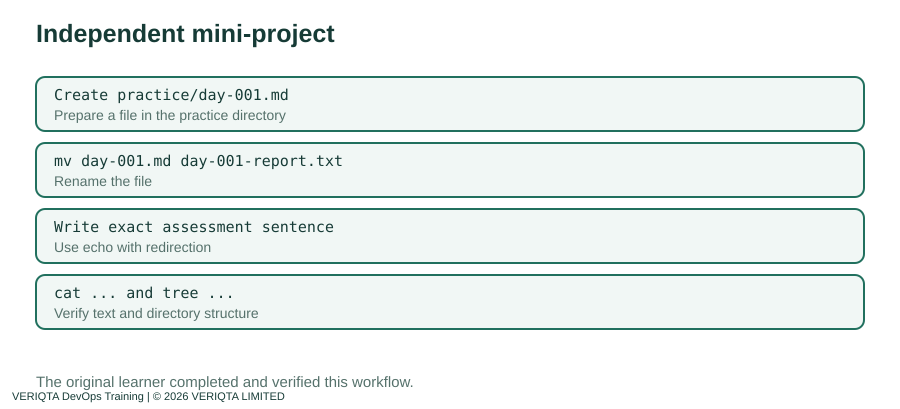

# Day 001 — Complete Instructor Notes
## Your Linux Environment and First Commands

This is your first day working like a DevOps engineer in a Linux terminal. I will introduce each idea, show you exactly what to type, explain what the output means, and give you a checkpoint to confirm that you understood it. **Do not rush ahead:** complete one checkpoint before the next section.

> **About example output:** Your machine's hostname, Ubuntu release, timestamps, and some directory listings can differ. Treat example outputs as illustrations, not strings you must reproduce.

## Before Step 1 — What are Linux, Ubuntu, the terminal, and the shell?

**Linux** is the kernel at the center of many operating systems used for servers, containers, cloud infrastructure, and embedded devices. In everyday speech, people often say “Linux” to mean a full Linux-based operating system. **Ubuntu** is one such distribution: it combines the Linux kernel with software, a package manager, system utilities, and configuration defaults.

A **terminal** is the text interface in which you type commands and see results. A **shell**, such as Bash, interprets your commands. The terminal displays the conversation; the shell interprets what you type.

When you access a remote Linux machine using **SSH** (Secure Shell), the terminal on your own computer communicates with a shell on that remote machine over an encrypted connection. The commands you run after connecting normally execute **on the remote server**, not on your laptop.

**Why DevOps engineers care:** Many cloud servers have no desktop interface. You must be comfortable checking identity, finding files, reading logs, and safely automating operations from a shell.


### Understand the prompt before typing

A prompt may look like:

```text
ubuntu@ip-10-0-0-5:~$
```

- `ubuntu` is the account you are using.
- `ip-10-0-0-5` is an illustrative hostname, **not** an address to copy.
- `~` represents your home directory.
- `$` indicates an ordinary shell prompt (a root shell commonly uses `#`).

**Do not type the prompt itself.** Type only the command shown after `$`. Press **Enter** to run it. A successful command may print nothing; that does not necessarily mean failure.

### Connection safety

If you use AWS EC2, connect using the SSH details for **your** instance and your own private key. Never put the private key or public IP in GitHub. Your cloud provider may charge for running instances, storage, and network traffic. If you are already connected to Ubuntu, continue with Step 1.

---

## Step 1 — Identify the operating system

You cannot safely choose package commands or troubleshoot a server until you know what operating system you are using.

**Run:**

```bash
cat /etc/os-release
```

**Let's explain every part.**

- `cat` reads a file and prints its contents in the terminal.
- `/etc/os-release` is a text file that identifies the installed operating system.
- The `/` at the start makes this an **absolute path**: it starts from the filesystem root.
- This command **reads** the file; it does not modify it.

**Typical output resembles:**

```text
NAME="Ubuntu"
PRETTY_NAME="Ubuntu 26.04 LTS"
ID=ubuntu
```

Your actual release can differ. The file may contain many more lines.

**What the output tells you:** `NAME` is the distribution name, `PRETTY_NAME` is a friendly release label, and `ID` is a machine-friendly identifier. LTS means *Long Term Support*.

**Verify Step 1:** Can you identify the operating system and its release from your output? If the file is missing, stop and check whether you are actually on a Linux machine.


---

## Step 2 — Identify who and where you are

Before modifying anything on a server, establish context: **which user, which machine, and which directory?** These three questions prevent many production mistakes.

**Run one command at a time:**

```bash
whoami
pwd
hostname
```

### Command A — `whoami`

`whoami` prints the effective username running the command.

**Example:**

```text
ubuntu
```

Why this matters: users have different permissions. A command that works for an administrator may fail for a regular user. You should not use `sudo` automatically just because a command fails.

### Command B — `pwd`

`pwd` means **print working directory**. It displays the full path to the directory your shell is currently in.

**Example:**

```text
/home/ubuntu
```

The path matters. Running `touch report.txt` in `/home/ubuntu` creates a different file from running it in `/home/ubuntu/devops-training`.

### Command C — `hostname`

`hostname` prints the computer's host name.

**Example:**

```text
ip-10-0-0-5
```

The example hostname is fictional. Yours will differ. This tells you **which machine** you are operating on, which becomes crucial when managing multiple servers.

### Checkpoint 2

Run all three again. Answer without guessing:
1. Which account is executing your commands?
2. Which directory are you in?
3. Which server are you connected to?

**Do not confuse** `whoami` with `hostname`, or `pwd` with either of them.


---

## Step 3 — Explore the Linux filesystem without changing anything

Think of the Linux filesystem as a tree. The top is `/`, called the **filesystem root**. Paths branch into directories and files beneath it.

**Run:**

```bash
ls /
```

`ls` lists directory entries. `/` asks it to list the root directory.

You may see directories such as:

```text
bin  boot  dev  etc  home  opt  root  tmp  usr  var
```

The actual listing depends on your system.

### What are these directories for?

| Directory | What it is commonly used for |
|---|---|
| `/` | Top of the filesystem hierarchy |
| `/home` | Home directories for regular users |
| `/etc` | System-wide configuration |
| `/var` | Variable data, including many logs |
| `/usr` | Installed programs and shared resources |
| `/tmp` | Temporary files |
| `/root` | Home directory of the root account |
| `/dev` | Device interfaces |

`/` and `/root` are **not the same thing**. `/` is the top of the entire filesystem; `/root` is one particular directory.

**Now try a detailed listing:**

```bash
ll /
```

On some Ubuntu interactive shells, `ll` is an alias that displays a long listing. It is **not guaranteed** to exist. If you see `command not found`, use the portable command:

```bash
ls -la /
```

- `-l` gives a long listing with permissions, owners, sizes, and timestamps.
- `-a` includes hidden entries whose names begin with `.`.

**Checkpoint 3:** Identify `/home`, `/etc`, and `/var` in the output. Explain their purpose. **Do not edit** any of these system directories during this exercise.


---

## Step 4 — Create your own DevOps training workspace

We have inspected the server without changing anything. Now we will make a **safe, dedicated workspace** inside your home directory.

**Command 1:**

```bash
mkdir -p ~/devops-training
```

- `mkdir` means **make directory**.
- `~` expands to your home directory.
- `-p` creates parent directories when needed and does not fail merely because the requested directory already exists.

**Command 2:**

```bash
cd ~/devops-training
```

`cd` means **change directory**. Your next relative file commands will operate from here.

**Command 3:**

```bash
pwd
```

**Example output:**

```text
/home/ubuntu/devops-training
```

**Command 4:**

```bash
mkdir 01-linux
```

This creates the folder for your first module. If you have already created it, Linux may report `File exists`; inspect it rather than deleting it. For a repeatable command, use `mkdir -p 01-linux`.

**Command 5:**

```bash
ls
```

Expected relevant entry:

```text
01-linux
```

### Why this organization matters

Engineers use predictable paths so that scripts, documentation, teammates, and CI/CD pipelines can find the right files. A directory name is part of an interface: if a script expects `01-linux`, calling it `linux-01` may break it.

**Checkpoint 4:** Does `pwd` show your workspace? Does `ls` show `01-linux`? If not, check each command and your spelling before continuing.


---

## Step 5 — Create directories, create a file, write to it, and verify it

Now we will create a small note inside the Linux module. This is your first end-to-end file operation.

**Command 1 — Enter the module:**

```bash
cd ~/devops-training/01-linux
```

**Commands 2 and 3 — Create the teaching and practice folders:**

```bash
mkdir -p notes
mkdir -p practice
```

We keep the note and the practical report separate so they are easy to find.

**Command 4 — Create the note file:**

```bash
touch notes/day-001.md
```

`touch` creates an empty file if it does not exist. If it already exists, `touch` updates timestamps instead of erasing its contents.

**Command 5 — Write your first sentence:**

```bash
echo "My first DevOps Linux lesson" > notes/day-001.md
```

Break it down:
- `echo` prints the supplied text.
- The quoted sentence is the text to print.
- `>` is **shell redirection**: it sends the output into a file rather than onto the screen.
- **Warning:** `>` overwrites the destination file's existing contents. Here that is intentional because we are writing a known practice note.

**Command 6 — Read and verify:**

```bash
cat notes/day-001.md
```

Expected:

```text
My first DevOps Linux lesson
```

**Command 7 — Confirm the file appears in its folder:**

```bash
ls notes
```

Expected relevant entry:

```text
day-001.md
```

### Why verification matters

A command returning to the prompt without an error does not prove that the file contains the right text. Engineers verify both **location** and **content**. In production, a configuration file with the wrong contents can break a service even when it exists.

**Checkpoint 5:** Confirm the path, filename, and exact sentence. If you wrote the wrong text, correct **only your training note** and check it again.


---

## Step 6 — Inspect the workspace with `tree` and recover from a missing command

A directory listing is useful, but nested projects are easier to understand as a tree.

**Command 1 — Return to the training root:**

```bash
cd ~/devops-training
```

**Command 2 — Try:**

```bash
tree
```

You may see an error like:

```text
Command 'tree' not found
```

This is a normal troubleshooting opportunity, not a reason to delete files or reinstall Linux.

### Investigate before changing anything

```bash
command -v tree
```

If nothing is printed and the command returns a nonzero status, the executable is not currently found on your shell's `PATH`.

### Install `tree` on Ubuntu, if needed

```bash
sudo apt update
sudo apt install tree
```

- `sudo` runs a command with elevated privileges when you are authorized.
- `apt update` refreshes package index information; it does not upgrade all installed packages.
- `apt install tree` installs the `tree` package.
- Read any prompts before confirming installation. Network access and package permissions are required.

**Then run:**

```bash
tree
```

Expected relevant structure:

```text
devops-training
└── 01-linux
    ├── notes
    │   └── day-001.md
    └── practice
```

The actual output may include other files and directories. If `tree` is unavailable and you cannot install it, use:

```bash
find ~/devops-training/01-linux -maxdepth 3 -print
```

This lists matching paths, though its display format differs.

**Checkpoint 6:** Locate `01-linux`, `notes/day-001.md`, and `practice`. Explain what you did when the command was missing.


---

## Step 7 — Guided mini-project: create and verify a practical report

Now use the same workspace to prepare a short report. This introduces **renaming** with `mv` and reinforces reading and writing files.

**Start from your module directory:**

```bash
cd ~/devops-training/01-linux
pwd
```

Expected path ends in `/devops-training/01-linux`.

**Create a temporary report filename:**

```bash
touch practice/day-001.md
```

**Rename it to the final report name:**

```bash
mv practice/day-001.md practice/day-001-report.txt
```

`mv` can move or rename a file. Here the source and destination are in the same directory, so it renames the file. It does **not** make a backup copy.

**Write the required report sentence:**

```bash
echo "Linux Day 1 practical assessment completed." > practice/day-001-report.txt
```

Notice **practical**, not **practice**. Exact text matters.

**Verify the report:**

```bash
cat practice/day-001-report.txt
```

Expected:

```text
Linux Day 1 practical assessment completed.
```

**Verify the note again:**

```bash
cat notes/day-001.md
```

Expected:

```text
My first DevOps Linux lesson
```

**Verify the structure:**

```bash
tree ~/devops-training/01-linux
```

Expected relevant paths:

```text
01-linux/
├── notes/
│   └── day-001.md
└── practice/
    └── day-001-report.txt
```

**Checkpoint 7:** Can you prove all three things: the correct folder structure, the correct note contents, and the correct report contents? If so, proceed to the independent practical assessment.



---

## Before you finish — How to think like an engineer

The goal is not to memorize a list of commands. You should be able to explain:
1. **Context:** Which user, host, and directory am I working in?
2. **Intent:** What exactly should this command change?
3. **Scope:** Am I changing only my practice workspace?
4. **Evidence:** Which command proves the result?
5. **Recovery:** If the command fails, what does the error actually say?

For every command in this lesson, practice naming the **program**, its **arguments**, and any **options**. For example, `ls -la /` uses program `ls`, options `-l` and `-a`, and target path `/`.

### Completion route

1. Repeat the steps using the [follow-along lab](../labs/follow-along-lab.md).
2. Complete the [exercises](../exercises/exercises.md).
3. Do the [Practical Assessment for Students](../assessments/practical-assessment.md) independently.
4. Answer the [Knowledge Check](../assessments/knowledge-check.md) **before** looking at its answer key.
5. Use the [troubleshooting guide](../troubleshooting/README.md) whenever an output differs.

You have now established the Linux workspace and basic verification habits you will use throughout VERIQTA DevOps Training.
