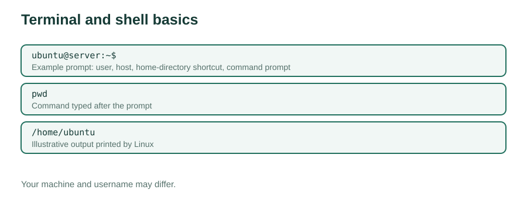
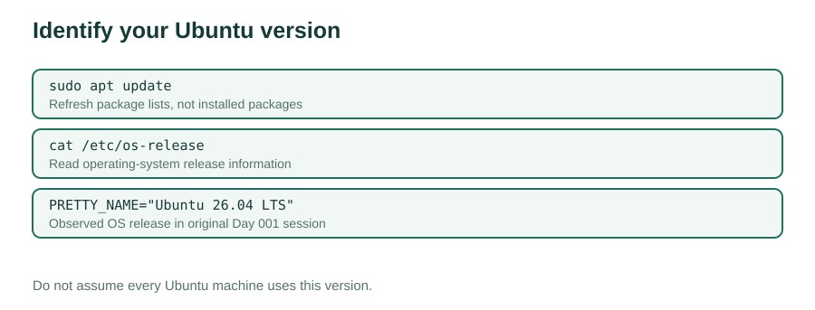
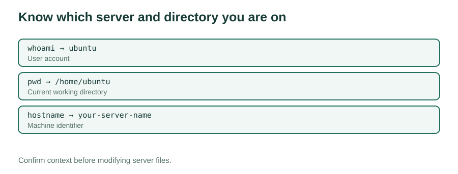
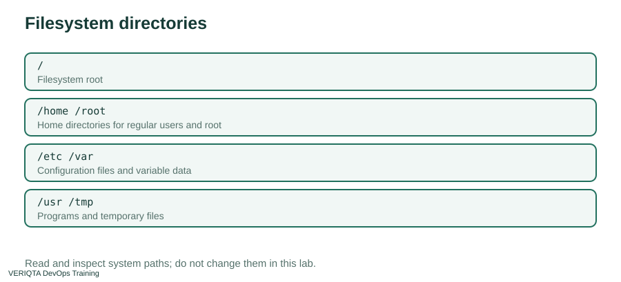
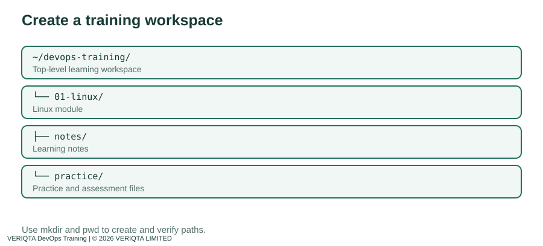
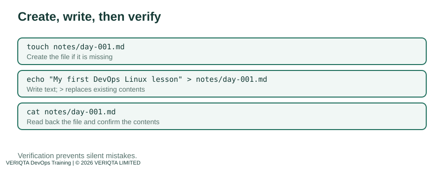
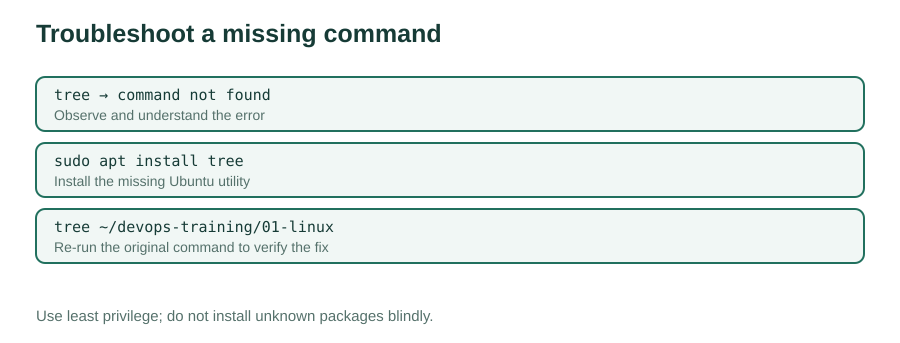

# VERIQTA DevOps Training | Day 001 — Complete Teaching Notes

You are starting from zero. Work through each explanation, run each command yourself, and compare your output with the checkpoints. The commands are for your own Ubuntu training machine; examples are illustrative and your machine may show different values.

## What is Linux and why does DevOps use it?
Linux is an operating system that manages a computer's hardware and allows programs to run. Many cloud servers, containers, and automation systems use Linux. The **terminal** is a text interface where you type commands into a **shell**, such as Bash. A command is an instruction; output is what the system prints in response.



## Step 1: Identify the Linux environment

On Ubuntu, first update the package *index* (this does not install upgrades):

```bash
sudo apt update
```

`sudo` runs the command with elevated privileges; `apt` is Ubuntu's package manager; `update` refreshes the available package lists. It may ask for your Linux password. On some EC2 images the configured user can run sudo without a password. Do not run a full upgrade just because updates are listed.

Then identify the OS:

```bash
cat /etc/os-release
```

`cat` displays file contents. `/etc/os-release` stores information about the operating system. You's output included `PRETTY_NAME="Ubuntu 26.04 LTS"` and `VERSION_CODENAME=resolute`. Your version may differ.

**Checkpoint 1:** Can you find `NAME`, `VERSION_ID`, and `PRETTY_NAME`? Record your result.



## Step 2: Identify your user, location, and hostname

Run these one at a time:

```bash
whoami
pwd
hostname
```

- `whoami` prints the currently effective username. A typical Ubuntu account displays `ubuntu`.
- `pwd` means **print working directory**. On an Ubuntu EC2 image, you might see `/home/ubuntu`.
- `hostname` prints the computer's host name. An EC2 host commonly has an `ip-...`-style hostname; your hostname will be different.

A terminal prompt might resemble `ubuntu@server:~$`. `ubuntu` is the username, `server` identifies the machine, `~` represents the user's home directory, and `$` is the usual unprivileged-shell prompt. Never type the prompt itself as part of a command.

**Checkpoint 2:** Write down your username, working directory, and hostname. Explain the difference between a user and a host.



## Step 3: Explore the filesystem

Run:

```bash
ls /
ll /
```

`/` is the **root directory** of the filesystem, not the root user's home folder. `ls /` lists entries at the root. `ll` is a common Ubuntu shell alias for a detailed listing, but it may not exist on every Linux system. If `ll` is unavailable, use:

```bash
ls -la /
```

Common directories include `/home` (user home directories), `/etc` (system configuration), `/var` (variable data and logs), `/usr` (programs and shared files), `/tmp` (temporary files), and `/root` (root user's home directory). Avoid modifying system directories during this beginner lesson.

**Checkpoint 3:** Identify at least three of these directories in the output and describe what they are used for.



## Step 4: Create your workspace

Run:

```bash
mkdir -p ~/devops-training
cd ~/devops-training
pwd
mkdir 01-linux
ls
```

`mkdir` creates a directory; `cd` changes the working directory; `~` expands to your home directory. The `-p` option allows you to rerun the command safely when the directory already exists. Do not delete an existing workspace.

Example `pwd` for an Ubuntu EC2 instance:

```text
/home/ubuntu/devops-training
```

Expected `ls` includes `01-linux`.

**Checkpoint 4:** Verify your `pwd` and confirm `01-linux` exists.



## Step 5: Create and read a file

Run:

```bash
cd ~/devops-training/01-linux
mkdir -p notes
mkdir -p practice
touch notes/day-001.md
echo "My first DevOps Linux lesson" > notes/day-001.md
cat notes/day-001.md
```

`touch` creates a missing empty file or updates timestamps if it exists. `echo` prints text. The `>` redirection operator **replaces the destination file's content**, so use it carefully. `cat` verifies what was written.

Expected output:

```text
My first DevOps Linux lesson
```

**Checkpoint 5:** Confirm `notes/day-001.md` exists and contains the sentence. Try `ls notes`.



## Step 6: Inspect the tree and troubleshoot

From the training root, try:

```bash
cd ~/devops-training
tree
```

If the shell prints `Command 'tree' not found`, the tool is not installed. On Ubuntu:

```bash
sudo apt update
sudo apt install tree
```

If asked to confirm installation, read the prompt and accept only if you intend to install the package. Then run `tree` again. You encountered the missing-command error, install `tree` and verify the directory tree.

`tree` recursively shows directory contents. For a targeted listing, use `tree 01-linux`. Avoid running it against extremely large directories without limiting its scope.

**Checkpoint 6:** Confirm `tree` shows `01-linux/notes/day-001.md` and your practice directory.



## Step 7: Independent practical assessment

Do not simply copy the answer from the assessment sheet. See [the assessment](../assessments/practical-assessment.md), perform the task, then compare with the verification instructions.

## DevOps connections

- Operating-system identification helps you select compatible packages and troubleshooting steps.
- `whoami`, `pwd`, and `hostname` establish context before changing files on a server.
- Predictable directories make scripts, repositories, and operations handoffs easier.
- Verifying file contents is as important as creating the file.
- Missing commands are normal. Investigate the error and install only the package you need.

## Optional deeper practice: read the command before running it

Before each command, identify its **program**, **arguments**, and **options**. For example, in `ls -la /`, `ls` is the program, `-la` selects a long listing including hidden entries, and `/` is the directory being listed. In `echo "text" > file`, the shell processes `>` and writes to `file`; `echo` does not directly open that file.

A command returning no text is not automatically a failure. `mkdir`, `cd`, and `touch` usually produce no output when successful. Verify with `pwd`, `ls`, or `cat`. For more detail, `echo $?` shows the exit status of the **immediately preceding** command: `0` normally means success, and nonzero means an error or other condition.

## Reflection and five-minute documentation

Record: what you built, what you verified, what failed, how you fixed it, and one question for tomorrow. Do not commit credentials, private keys, or sensitive host information to a public GitHub repository.

---
