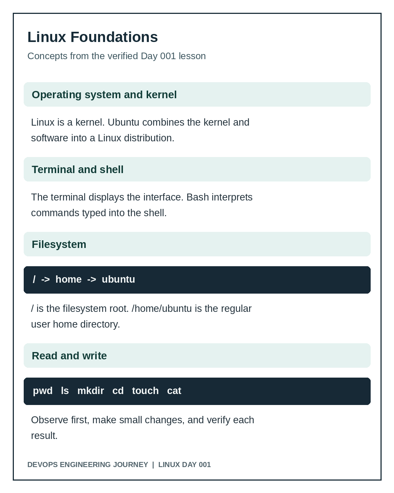

# Day 001 Teaching Notes: Linux From Zero

## 1. What is an operating system?
An operating system manages processes, memory, storage, user access, and hardware resources. Linux is a kernel; Ubuntu is a distribution that packages the Linux kernel with supporting software.

## 2. Terminal, shell, and prompt
A terminal is an interface to interact with a shell. The shell parses and runs commands. In `ubuntu@ip-172-31-16-89:~$`, `ubuntu` is the username, the next part is the hostname, `~` means home, and `$` indicates a regular user prompt in common shell configurations.

## 3. Filesystem concepts
`/` is the filesystem root. `/home/ubuntu` is the regular user's home directory. `/etc` commonly holds configuration, `/var` changing data and logs, `/usr` programs and libraries, `/tmp` temporary data, `/root` the root user's home. `~` expands to the current user's home directory in the shell.

## 4. Commands used
| Command | Purpose | Caution |
|---|---|---|
| `cat /etc/os-release` | Read OS identification | Read-only |
| `whoami` | Display effective username | Read-only |
| `pwd` | Print current directory | Read-only |
| `hostname` | Display system hostname | Read-only |
| `ls /` | List filesystem root | Read-only |
| `ll /` | Detailed listing, where alias exists | Not universal |
| `mkdir DIR` | Create directory | Fails if already exists |
| `cd DIR` | Change working directory | Changes shell location |
| `touch FILE` | Create empty file or update timestamps | Does not populate content |
| `echo "text" > FILE` | Replace file content with text | `>` overwrites contents |
| `cat FILE` | Display file contents | Read-only |
| `mv OLD NEW` | Move or rename | May overwrite existing target |
| `tree` | Display directory hierarchy | May require installation |

## 5. Paths
An absolute path begins with `/`, for example `/home/ubuntu/devops-training`. A relative path is interpreted from the current directory, for example `notes/day-001.md`. `.` means current directory; `..` means parent directory.

## 6. Engineering habit
Observe, act, verify, and record evidence. Never assume a command succeeded solely because it printed no error. Use `pwd`, `ls`, or `cat` to check the intended outcome.

## 7. Real-world relevance
Linux directory layout, shell commands, file editing, and verification are foundational to server operations, infrastructure-as-code, containers, and Kubernetes. This introductory lab does not establish production proficiency; it starts the habit of repeatable technical work.
