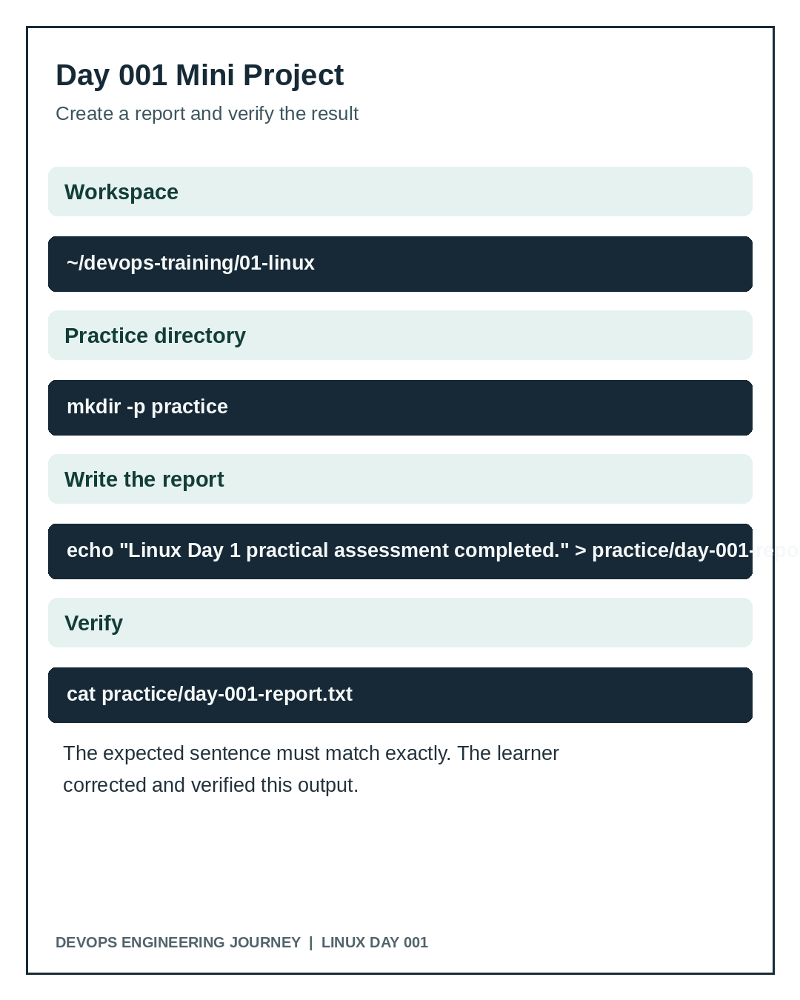

# Mini Project: First Linux Practice Report



## Scenario
As a new DevOps engineer, create an organized workspace and a verifiable status report.

## Requirements
- Work under `~/devops-training/01-linux`.
- Create `practice/`.
- Create `practice/day-001-report.txt`.
- File content must match exactly: `Linux Day 1 practical assessment completed.`
- Verify both the directory structure and file contents.

## One reproducible solution
```bash
cd ~/devops-training/01-linux
mkdir -p practice
printf '%s\n' 'Linux Day 1 practical assessment completed.' > practice/day-001-report.txt
ls practice
cat practice/day-001-report.txt
```

## Observed learner approach
The learner created `practice`, initially created `day-001.md`, used `mv` to rename it to `day-001-report.txt`, wrote a near-match sentence, and then corrected the text. A final screenshot confirmed the exact expected sentence.

## Verification
The screenshot of `tree` showed `01-linux/notes/day-001.md` and `01-linux/practice/day-001-report.txt`. The final `cat` screenshot displayed `Linux Day 1 practical assessment completed.`

## Assessment
**Passed:** directory and file operations, independent adaptation with `mv`, final content correction, and verification. No application deployment or cloud configuration was part of this first mini project.
