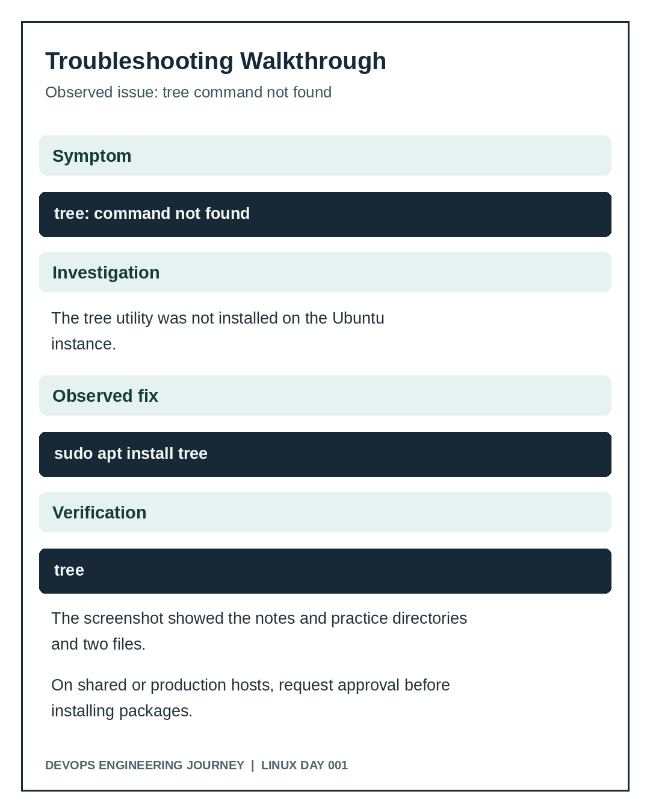

# Day 001 Troubleshooting Record

## Incident: `tree` command not found
**Observed symptom:** running `tree` produced a `command not found` message.

**Likely cause:** the `tree` utility was not installed in the Ubuntu environment.

**Observed response:** the learner ran `sudo apt install tree` and the package installation completed. The following `tree` command displayed the expected directory structure and reported 4 directories and 2 files.

**Verification:** screenshot shows `01-linux/notes/day-001.md` and `01-linux/practice/day-001-report.txt`.

**Engineering lesson:** distinguish missing software from incorrect syntax. Confirm the command exists and the package source is trusted before installing. Package installation changes system state and can require approval on shared or production systems.

## Issue: exact output did not match requirement
**Observed:** initial report text used `practice assessment` instead of `practical assessment`.

**Correction:** file content was updated. A final `cat` output showed the exact expected sentence.

**Engineering lesson:** passing syntax checks is not enough. Verify requirements exactly, including strings, paths, and filenames.

## Other possible errors (not observed)
- `File exists` from `mkdir`: inspect existing directory or use `mkdir -p` where appropriate.
- `No such file or directory` from `cat`: check current directory with `pwd` and filename with `ls`.
- `Permission denied`: inspect ownership and permissions; do not immediately use `sudo`.
- Overwritten file due to `>`: avoid redirecting to important files without inspecting them first.
