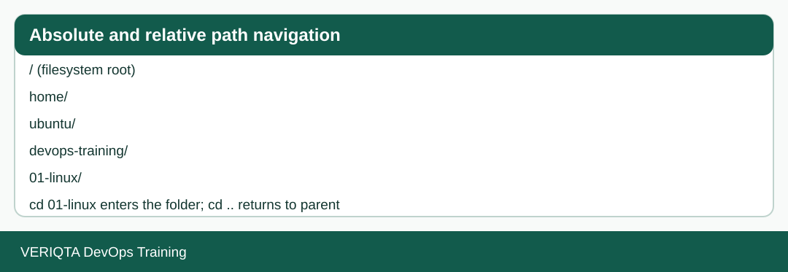
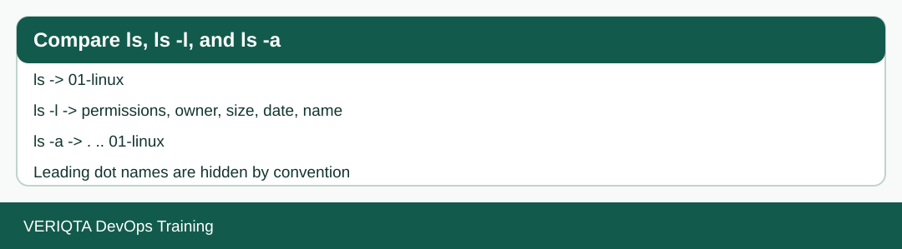
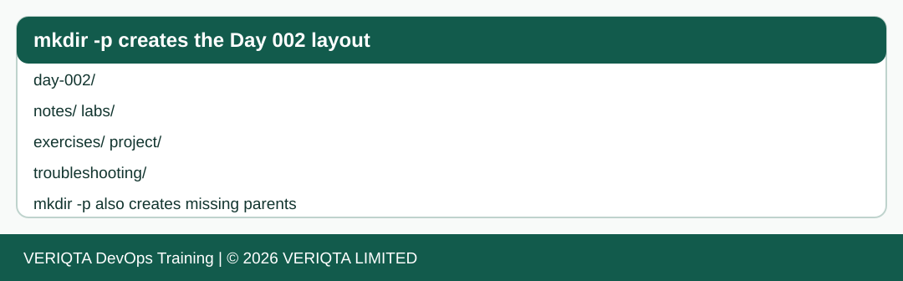
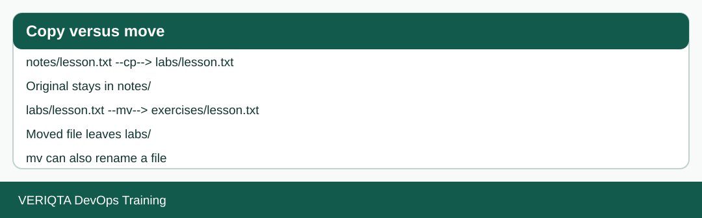
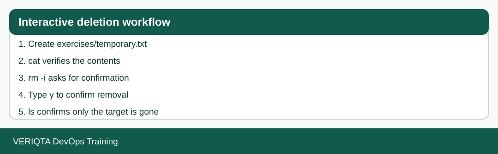
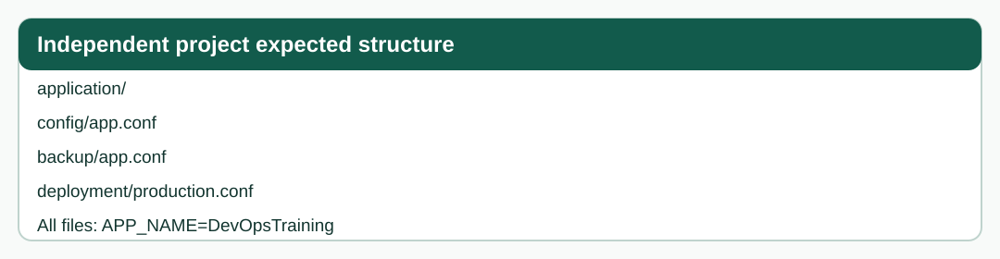

# Linux Day 002: Filesystem Navigation and File Management

**Course:** DevOps Training from Zero to Professional  
**Module:** 01, Linux  
**Environment:** Ubuntu 26.04 LTS on a training AWS EC2 instance  
**Session:** Approximately 60 minutes, extend as needed  
**Prerequisite:** Day 001, a working Linux terminal and `~/devops-training/01-linux`  
**Status:** Instructor-verified practical assessment 100/100; knowledge check 3/3.

This is a public follow-along lesson. Commands are intended for a **personal training environment**, not an arbitrary production server. You can complete it without AWS by using a local Linux machine and adjusting the home path. Do not commit passwords, keys, or sensitive terminal screenshots.

## What you will learn

1. Navigate using absolute and relative paths, `pwd`, `cd`, `..`, `~`, and `/`.
2. List visible and hidden entries using `ls`, `ls -l`, and `ls -a`.
3. Build nested directories with `mkdir -p` and Bash brace expansion.
4. Copy files with `cp` and verify their contents with `cat`.
5. Move and rename files with `mv -i`.
6. Delete a temporary file using `rm -i` and verify that other files remain intact.
7. Build a small application configuration workspace independently.

## Start here

Read [the complete lesson](notes/day-002-complete-lesson.md) and perform each checkpoint in order. Use [the guided lab](labs/follow-along-lab.md) as a terminal checklist. Then complete [the exercises](exercises/exercises.md) and [the independent project](project/README.md). Consult [troubleshooting](troubleshooting/troubleshooting.md) if commands fail, and check [the assessments](assessments/assessment-and-knowledge-check.md) only after attempting the questions.

## Visual walkthroughs








## Evidence and reproducibility

The original learner demonstrated these operations in terminal screenshots reviewed during the session. This repository contains **reproducible example files and diagrams**, not fabricated terminal captures. The project files are supplied as reference artifacts; independently recreate them in your own terminal. Verification commands are included in every step.

## Expected completed project

```text
project/
└── application/
    ├── backup/app.conf
    ├── config/app.conf
    └── deployment/production.conf
```

Each file should contain exactly `APP_NAME=DevOpsTraining` followed by a newline.

## Continue learning

After completing the lab and passing the checks, continue to Day 003. The learning record is educational evidence, not proof of production engineering experience.
