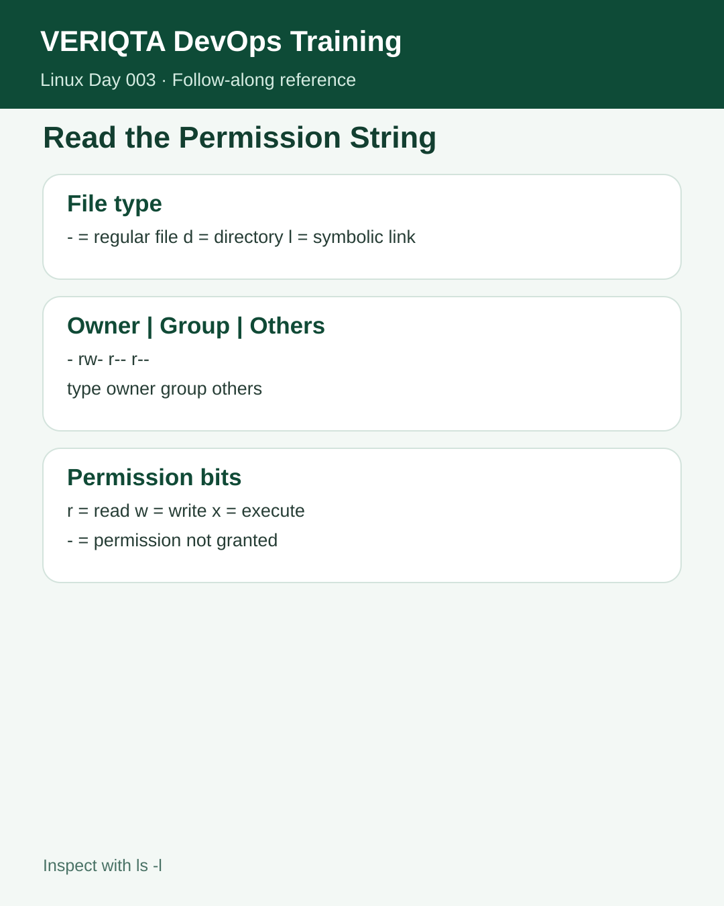
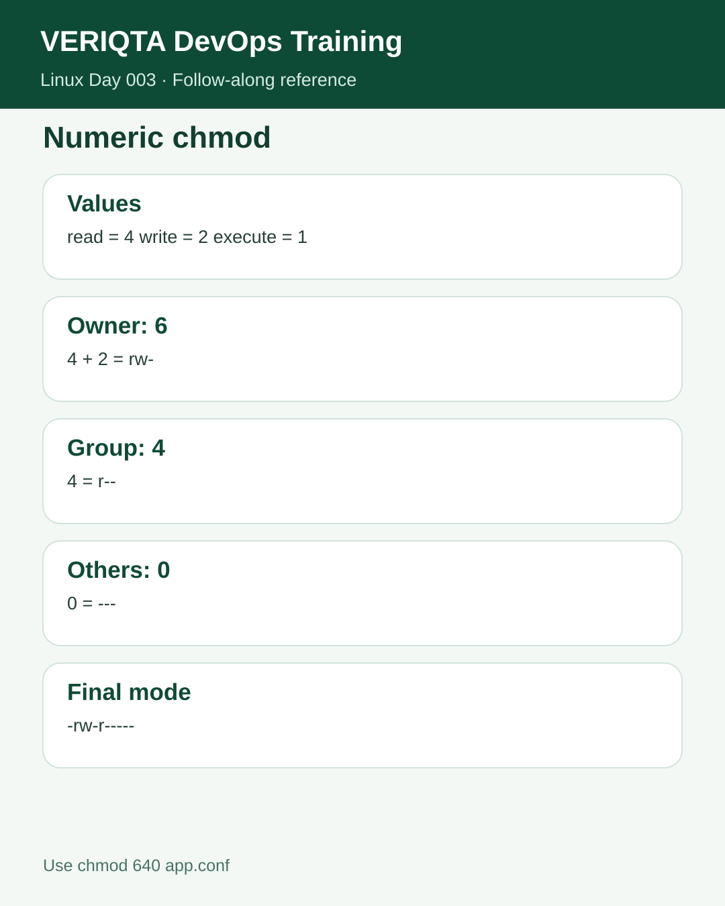
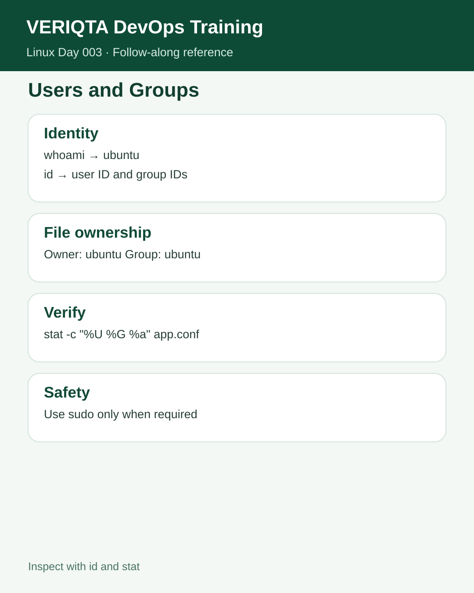
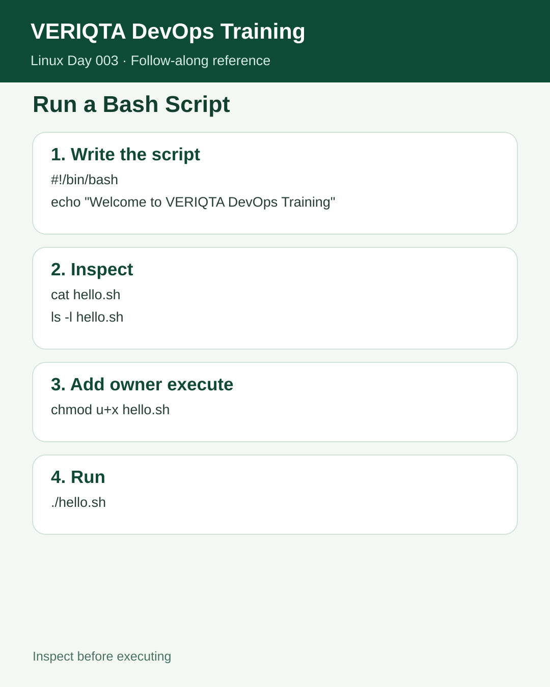
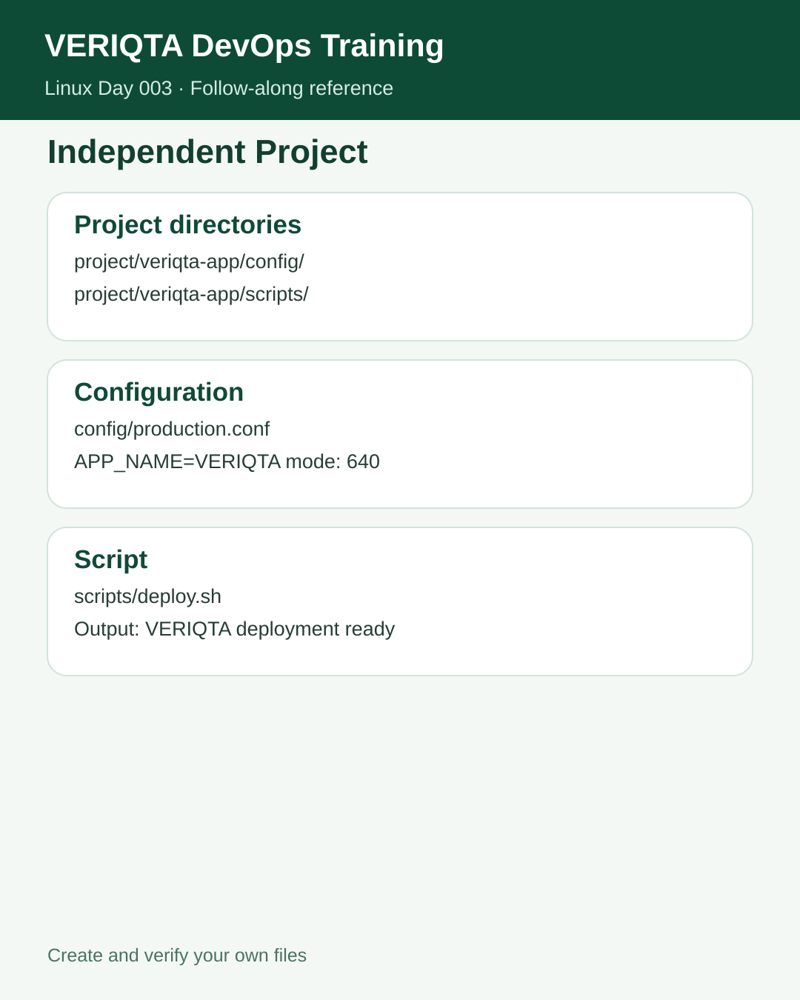
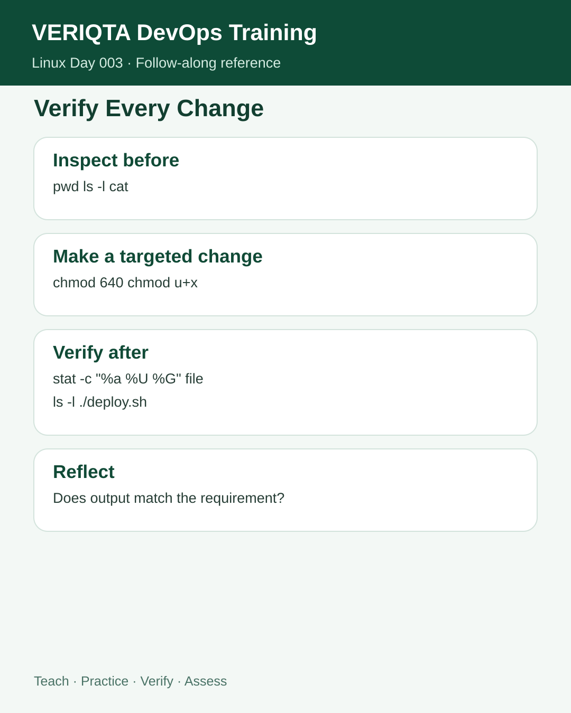

# Day 003 — Complete Instructor Notes
## Understanding Linux Files, Permissions, and Ownership

Welcome to Day 003. In Day 002 you created, copied, renamed, and removed files. Today we are asking a new question: **who is allowed to do those things?**

Imagine an application configuration file contains database connection settings. You might need the application account to read it, but you do not want every user on the server to edit it. Linux permissions help you express those rules.

This class has **seven stages**. Do not jump directly to the independent project. At each stage, read the explanation, run the commands, inspect the results, and answer the checkpoint. Your terminal's exact timestamps and some permission defaults may differ from the examples.

## Before Step 1 — The permission model in plain language

Every ordinary Linux file has an owning **user**, an owning **group**, and permission bits that describe access for three categories:

- **Owner (user):** The user who owns the file.
- **Group:** Users who belong to the file's owning group, when they are not the owner.
- **Others:** Everyone else.

The three basic permissions are:

| Symbol | On a regular file | On a directory |
|---|---|---|
| `r` | Read file contents | List names inside, subject to other permissions |
| `w` | Modify file contents | Create, remove, or rename entries, normally requiring `x` too |
| `x` | Execute a program/script directly | Traverse/search the directory and access known paths |

A directory's `x` bit does **not** mean “run the directory as a script.” It means you can traverse it.

A permission string might look like `-rw-r-----`:

```text
-  rw-  r--  ---
│   │    │    └── Others: no access
│   │    └─────── Group: read only
│   └──────────── Owner: read and write
└──────────────── Regular file
```

The first character identifies the file type: `-` for a regular file and `d` for a directory. The next nine characters are three permission triplets. Permission checks can also be affected by ACLs, privileged accounts, mount settings, and other security controls; these basic bits are the foundation, not the entire security system.



---

## Step 1 of 7 — Identify your Linux user and groups

Before deciding who can access a file, you need to know which account you are using and which groups it belongs to.

**Command 1:**

```bash
whoami
```

`whoami` prints your effective username. On a typical Ubuntu EC2 instance, the output is:

```text
ubuntu
```

**Command 2:**

```bash
id
```

This prints your user ID (UID), primary group ID (GID), and supplementary groups. An illustrative result is:

```text
uid=1000(ubuntu) gid=1000(ubuntu) groups=1000(ubuntu),4(adm),27(sudo)
```

Your actual group list can be longer or shorter. The number `1000` is common for the first regular user, but it is not universal.

**Command 3:**

```bash
groups
```

This displays your group memberships as names, for example:

```text
ubuntu adm cdrom sudo dip lxd
```

Do not expect those exact groups on every server.

### Why groups matter

Imagine a shared deployment directory used by several engineers. Instead of granting access to everyone, an administrator may grant permissions to a specific group. Group membership helps determine whether the group permission triplet applies.

Being in the `sudo` group on some Ubuntu configurations can allow authorized privileged operations, but **you should not use `sudo` by default**. Elevated commands have greater impact if the path is wrong.

### Verification checkpoint 1

Run `whoami`, `id`, and `groups` again. Identify:
1. Your username.
2. Your UID and primary GID.
3. At least one supplementary group, if any.
4. Whether your account appears to be a member of `sudo`.

**Stop if you cannot distinguish the username from the group name.** They may happen to be spelled the same, but they represent different things.

---

## Step 2 of 7 — Read directory permissions and ownership

Now let's inspect the workspace you built in the previous two lessons.

**Command 1 — Enter your Linux module:**

```bash
cd ~/devops-training/01-linux
```

**Command 2 — Confirm your location:**

```bash
pwd
```

Expected example:

```text
/home/ubuntu/devops-training/01-linux
```

**Command 3 — Inspect the entries in this directory:**

```bash
ls -l
```

This displays each entry with permissions, owner, group, size, timestamp, and name.

**Command 4 — Inspect the Day 002 directory itself:**

```bash
ls -ld day-002
```

The distinction is important. `ls -l day-002` normally lists the *contents* of `day-002`. Adding `-d` asks `ls` to describe the **directory entry itself**.

An illustrative output is:

```text
drwxrwxr-x 7 ubuntu ubuntu 4096 Oct 21 16:00 day-002
```

Read it from left to right:

- `d`: this is a directory.
- `rwx`: the owner can read, write, and traverse it.
- `rwx`: the owning group can read, write, and traverse it.
- `r-x`: others can read and traverse it but not modify its entries.
- `ubuntu ubuntu`: owning user and owning group.

The link count, byte size, timestamp, and permission triplets may differ on your machine. If you do not have `day-002`, inspect a harmless directory you own instead; do not invent results.

### Why engineers inspect directory permissions

You may be able to read a file but still be unable to reach it if you lack traversal permission on a parent directory. Likewise, deleting a file usually depends on permissions on its **containing directory**, not simply the file's own write bit.

### Verification checkpoint 2

Explain what the leading `d` means. Identify the owner, group, and three triplets. Then explain why `ls -ld day-002` answers a different question from `ls -l day-002`.

---

## Step 3 of 7 — Create a configuration file and inspect its initial permissions

We will now build a safe practice directory and create an application configuration file.

**Command 1 — Create the workspace:**

```bash
mkdir -p day-003/permissions-lab
```

`mkdir -p` creates missing parent directories. It also tolerates a directory that already exists. It does not erase your previous work.

**Command 2 — Enter it:**

```bash
cd day-003/permissions-lab
```

**Command 3 — Write the configuration:**

```bash
echo "APP_NAME=VERIQTA" > app.conf
```

- `echo` produces the text.
- `>` redirects the text to `app.conf`.
- **Caution:** `>` replaces existing file contents. Here it is intentional inside a dedicated training file.

**Command 4 — Read the file:**

```bash
cat app.conf
```

Expected output:

```text
APP_NAME=VERIQTA
```

**Command 5 — Inspect its metadata:**

```bash
ls -l app.conf
```

An illustrative result is:

```text
-rw-rw-r-- 1 ubuntu ubuntu 16 Oct 21 16:10 app.conf
```

The leading `-` means **regular file**, unlike the `d` you saw for directories. Your exact initial permission bits can differ because of the process **umask**, which removes selected permissions from the defaults used when creating files.

### What is `umask`?

New regular files are generally created without execute permission unless a program explicitly requests it. The process's `umask` filters permission bits from the requested creation mode. For example, with a common umask of `0022`, new ordinary files are often `644`; with `0002`, they are often `664`. **Do not assume every new file starts with the same permissions.**

### Verification checkpoint 3

Confirm that:
- You are inside `day-003/permissions-lab`.
- `app.conf` contains exactly `APP_NAME=VERIQTA`.
- `ls -l` shows a regular file, not a directory.
- You can identify the owner, group, and permission triplets.

If the contents are wrong, correct only the training file and read it again.

---

## Step 4 of 7 — Change permissions using symbolic and numeric `chmod`

Now we will restrict access to `app.conf`.

The command `chmod` means **change mode**. There are two common ways to express permission changes.

### Symbolic mode: change selected bits

**Command 1:**

```bash
chmod o-r app.conf
```

Breakdown:
- `o`: others.
- `-`: remove.
- `r`: read permission.
- `app.conf`: target file.

This removes read permission from the **others** category while leaving other permission bits unchanged.

**Command 2 — Inspect the result:**

```bash
ls -l app.conf
```

The exact result depends on the initial mode. For a file that began as `-rw-rw-r--`, the result would be `-rw-rw----`.

### Numeric mode: set an exact basic permission pattern

Linux permission digits are calculated using:

| Permission | Value |
|---|---:|
| Read (`r`) | 4 |
| Write (`w`) | 2 |
| Execute (`x`) | 1 |

Add the values **within each category**:

- Owner: read + write = `4 + 2 = 6`.
- Group: read = `4`.
- Others: no permission = `0`.

Together, the three digits are **640**.



**Command 3 — Set the exact mode:**

```bash
chmod 640 app.conf
```

**Command 4 — Inspect it:**

```bash
ls -l app.conf
```

Expected permission string:

```text
-rw-r-----
```

**Command 5 — Confirm the contents were not changed:**

```bash
cat app.conf
```

Expected:

```text
APP_NAME=VERIQTA
```

**Optional numeric verification:**

```bash
stat -c '%a' app.conf
```

Expected:

```text
640
```

### Why 640 is often useful

A configuration file may need to be writable by its owner, readable by an authorized group, and unavailable to other local users. However, `640` is secure **only if the owner and group are appropriate**. Do not assume the group is trusted without checking membership and service requirements.

### Why not `chmod 777`?

`777` grants read, write, and execute to owner, group, and others. For a configuration file, this is usually far more access than needed. It also grants execute permission to a file that does not need it. Permission changes should solve a specific access requirement, not simply remove restrictions.

### Verification checkpoint 4

Can you explain why `640` means `rw- r-- ---`? Show the permission string and confirm the contents remain unchanged. **Do not continue until both checks pass.**

---

## Step 5 of 7 — Inspect and understand file ownership

Permissions are only part of the picture. The **owner and group** determine which permission triplet applies to a user.

**Command 1 — Inspect the file:**

```bash
ls -l app.conf
```

**Command 2 — Produce a clear, formatted ownership report:**

```bash
stat -c 'Owner: %U | Group: %G | Permissions: %a' app.conf
```

The `stat` command displays filesystem metadata. The `-c` option supplies a format:

- `%U` = owning username.
- `%G` = owning group name.
- `%a` = numeric permission bits in octal form.

Expected on the standard Ubuntu practice environment:

```text
Owner: ubuntu | Group: ubuntu | Permissions: 640
```

**Command 3 — Assign the file to the existing `ubuntu` group:**

```bash
chgrp ubuntu app.conf
```

`chgrp` changes the owning group. Here it may simply reassign the group the file already has. This is intentional practice with the command, **not proof that access changed**.

**Command 4 — Check the result:**

```bash
ls -l app.conf
```

**Command 5 — Explicitly assign the expected owner and group:**

```bash
sudo chown ubuntu:ubuntu app.conf
```

`chown` changes ownership; the syntax `user:group` identifies both. `sudo` requests elevated privileges. On a machine where your account is not `ubuntu`, do not copy this literally: replace `ubuntu:ubuntu` with the correct account and group **only for your practice file**.

**Command 6 — Verify the final state:**

```bash
stat -c 'Owner: %U | Group: %G | Permissions: %a' app.conf
```

Expected:

```text
Owner: ubuntu | Group: ubuntu | Permissions: 640
```



### What did we actually prove?

We proved the command syntax works in our practice environment and that the file's final owner, group, and numeric mode match the requirement. Because the file was already owned by `ubuntu:ubuntu`, we did **not** demonstrate transferring ownership to another user or group. That would require another authorized account or group and is unnecessary for this beginner lab.

### Verification checkpoint 5

Identify the difference between `chmod`, `chgrp`, and `chown`. Explain which command changes permissions, which changes group ownership, and which can change the owner and group.

---

## Step 6 of 7 — Create and execute a Bash script

Until now, our file has been data. Next we will create a small script: a text file containing commands that Bash can execute.

### What is a Bash script?

A shell script automates a sequence of commands. In DevOps, scripts can perform environment checks, prepare deployments, verify files, and run repeatable maintenance tasks. Before executing an unfamiliar script, **inspect it**; execute only code you understand and trust.

**Command 1 — Write the first line:**

```bash
printf '#!/bin/bash\n' > hello.sh
```

`printf` produces formatted output. `\n` represents a newline. `>` writes the result into `hello.sh`.

The first line is:

```bash
#!/bin/bash
```

This is a **shebang**. When the script is executed directly, it tells the operating system which interpreter to use. On the Ubuntu environment used for this class, `/bin/bash` is the Bash interpreter path.

**Command 2 — Append the command that prints a welcome message:**

```bash
echo 'echo "Welcome to VERIQTA DevOps Training"' >> hello.sh
```

Notice the **double** `>>`: it **appends** to the file instead of replacing the shebang. The outer single quotes prevent the shell from interpreting the inner double quotes prematurely.

**Command 3 — Inspect the script before running it:**

```bash
cat hello.sh
```

Expected:

```bash
#!/bin/bash
echo "Welcome to VERIQTA DevOps Training"
```

**Command 4 — Check the permissions:**

```bash
ls -l hello.sh
```

The owner may not have execute permission yet. That is normal for a newly created text file.

**Command 5 — Add execute permission for the owner only:**

```bash
chmod u+x hello.sh
```

- `u`: user/owner.
- `+`: add.
- `x`: execute.

This changes only the owner's execute bit, preserving other permission bits.

**Command 6 — Verify the new permission:**

```bash
ls -l hello.sh
```

The owner triplet should now include `x`, for example `rwx`.

**Command 7 — Execute the script from the current directory:**

```bash
./hello.sh
```

Expected:

```text
Welcome to VERIQTA DevOps Training
```



### Why `./hello.sh`?

`./` means “the file named `hello.sh` in the current directory.” The shell does not normally search the current directory automatically for executable commands, so writing only `hello.sh` may produce `command not found`.

### Why `bash hello.sh` can behave differently

```bash
bash hello.sh
```

asks Bash to read and interpret the file directly; it generally requires read access but does **not** require the file's execute bit. `./hello.sh` requests direct execution and normally requires execute permission and a valid interpreter path. In this class, use `./hello.sh` so you practice the execute permission you just added.

### Verification checkpoint 6

Prove all three:
1. `cat hello.sh` shows exactly the two expected lines.
2. `ls -l hello.sh` shows the owner has execute permission.
3. `./hello.sh` prints the expected welcome message.

If you see `Permission denied`, do not use `chmod 777`; inspect the file and the directory path first.

---

## Step 7 of 7 — Independent project: Secure a VERIQTA application

Now you will work as the engineer preparing a simple application for deployment. This is the **same independent practical project** that follows the guided permission and script labs.

**Your workspace:**

```text
~/devops-training/01-linux/day-003
```

**Target structure:**

```text
day-003/
├── permissions-lab/
│   ├── app.conf
│   └── hello.sh
└── project/
    └── veriqta-app/
        ├── config/
        │   └── production.conf
        └── scripts/
            └── deploy.sh
```

Your earlier `permissions-lab` must remain intact.

### Project requirement A — Directory layout

Create `project/veriqta-app/config` and `project/veriqta-app/scripts`. Keep the directories separate so configuration and scripts are easy to locate.

### Project requirement B — Production configuration

Create:

```text
project/veriqta-app/config/production.conf
```

It must contain exactly:

```text
APP_NAME=VERIQTA
```

### Project requirement C — Secure the configuration

Set the configuration to **numeric mode 640**. Verify its owner and group. On the standard Ubuntu EC2 training environment, the expected owner and group are `ubuntu` and `ubuntu`.

### Project requirement D — Deployment script

Create:

```text
project/veriqta-app/scripts/deploy.sh
```

Its contents must be:

```bash
#!/bin/bash
echo "VERIQTA deployment ready"
```

Set its numeric mode to **744**:

- Owner `7` = read, write, execute.
- Group `4` = read only.
- Others `4` = read only.

This is deliberately more restrictive than `777`. It lets the owner execute the script but does not grant execution to the group or others.

### Project requirement E — Verification

Prove the project structure, file contents, ownership, numeric modes, and script output. Your script must print:

```text
VERIQTA deployment ready
```

**Try independently before opening the reference solution.** The commands below are for verifying the result, not for replacing your own problem-solving.

From the Day 003 directory:

```bash
tree project
cat project/veriqta-app/config/production.conf
stat -c 'Owner: %U | Group: %G | Permissions: %a' project/veriqta-app/config/production.conf
cat project/veriqta-app/scripts/deploy.sh
stat -c 'Owner: %U | Group: %G | Permissions: %a' project/veriqta-app/scripts/deploy.sh
./project/veriqta-app/scripts/deploy.sh
```

Expected numeric modes are `640` for the configuration and `744` for the script.

### A common real-world mistake

Typing `ls-l` instead of `ls -l` is not the same command. Linux interprets `ls-l` as a single program name. The correct command has a space between `ls` and `-l`. Read error messages carefully and correct the **smallest** issue.

### Project marking

The independent [Practical Assessment for Students](../assessments/practical-assessment.md) uses five criteria, each worth 20 points, for a total of **100 points**. You must demonstrate results, not merely show typed commands.




---

## Day 003 completion: What you now know

You can identify your user and groups, interpret file and directory permissions, choose a least-privilege mode for a configuration file, inspect owner and group, and make a Bash script executable.

Before moving to Day 004, explain these distinctions aloud:

- **Read permission versus execute permission.**
- **File execute versus directory traverse.**
- **Symbolic `chmod u+x` versus numeric `chmod 744`.**
- **Permissions (`chmod`) versus ownership (`chown`, `chgrp`).**
- **Inspecting a script versus executing it.**
- **Creating a file versus verifying that it has the right contents and mode.**

Finish the [Practical Assessment for Students](../assessments/practical-assessment.md), then answer the [three classroom knowledge-check questions](../assessments/knowledge-check.md) **one at a time** before consulting the [separate answer key](../assessments/knowledge-check-answers.md).

**Next:** Day 004 — Reading, Searching, and Processing Text Files in Linux.
