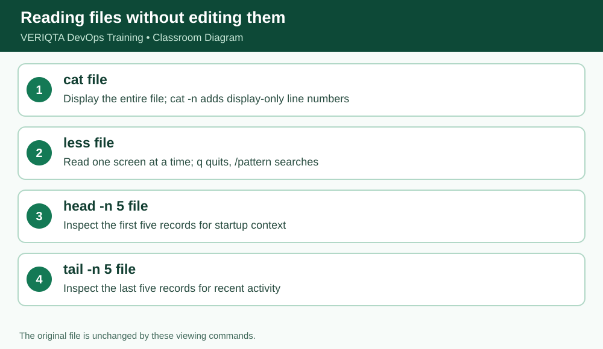

# VERIQTA DevOps Training — Day 004 Notebook
## Stage 1 of 7: Reading logs with cat

**Level:** Absolute beginner. **System:** Ubuntu/Linux terminal. **Scope:** simulated training files, not production access.

### Learning outcome
Understand **cat** and demonstrate the behavior by running commands and checking actual output.

### Explanation from first principles
`cat` prints a file to standard output; it does not open an editor or change the file. Use `cat -n` to add display-only line numbers. The file itself is not numbered. Start with `pwd` and `ls -l` to establish your location and file existence. A log is an ordered record of observations, but not necessarily a complete account of what happened.

### Before you begin
```bash
cd ~/devops-training/01-linux/day-004
pwd
```
Ensure the sample files have been created using `setup/prepare-practice-files.sh` or the exact here-documents in `notes/complete-lesson.md`.

### Follow-along commands (run one at a time)
```bash
pwd
```
```bash
ls -l application.log
```
```bash
cat application.log
```
```bash
cat -n application.log
```

### Expected observation and verification
Verify ten records and source line numbers 1 through 10. First line: application started. Three lines contain ERROR.

### Why this matters in a production investigation
When debugging a failure, use commands that let you inspect and summarize evidence reproducibly without editing original logs. Verify your working directory, file paths and line counts before drawing conclusions.

### Practical exercises
1. Explain the command in plain English without reading the solution.
2. Predict its output before running it, then compare the actual result.
3. Explain which file, if any, the command changes.
4. Record any unexpected output and the command you used to investigate it.

### Checkpoint before continuing
- [ ] Commands executed from the expected directory
- [ ] Output matches the expected observations
- [ ] Original source file remains intact
- [ ] Can explain the command without memorizing syntax alone

**Evidence instruction:** Capture your own screenshot if learning interactively. No fabricated screenshot is included in this public package.


## Instructor deep dive — cat prints entire file

cat is short for concatenate. With one filename it writes that file to the terminal; with several it prints them in sequence. cat -n adds line numbers to DISPLAY, not the underlying bytes. Avoid cat for huge or binary files; use less, head or tail.



### Demonstrate the commands individually

Run these one by one, **not as a pasted block**, and inspect the result after each command:

```bash
cat application.log
cat -n application.log
wc -l application.log
```

**Interpretation:** A log is evidence of recorded events, not proof of all events. Use cat -n to reference a specific original line in your incident notes.

### Self-explanation checkpoint

Before continuing, explain (1) the command's input, (2) what it writes to standard output, (3) whether it changes any file, and (4) how to recognize incorrect output. If your result differs, confirm `pwd`, `ls -l`, spelling and case, then repeat safely.

### Practice without copying

Reproduce the demonstration from memory, then check your output. Predict what would change if the source file gained another `ERROR` line; distinguish an observation from a hypothesis.
