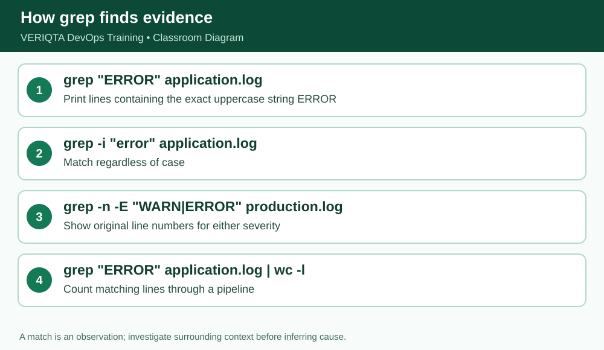

# VERIQTA DevOps Training — Day 004 Notebook
## Stage 3 of 7: Searching with grep

**Level:** Absolute beginner. **System:** Ubuntu/Linux terminal. **Scope:** simulated training files, not production access.

### Learning outcome
Understand **grep** and demonstrate the behavior by running commands and checking actual output.

### Explanation from first principles
`grep` selects matching lines. By default matches are case-sensitive. `-i` ignores case, `-n` prints original source line numbers, and `-E` allows `WARN|ERROR` alternation. Quote patterns containing `|` so the shell does not interpret it as a pipeline.

### Before you begin
```bash
cd ~/devops-training/01-linux/day-004
pwd
```
Ensure the sample files have been created using `setup/prepare-practice-files.sh` or the exact here-documents in `notes/complete-lesson.md`.

### Follow-along commands (run one at a time)
```bash
grep "ERROR" application.log
```
```bash
grep -i "error" application.log
```
```bash
grep -n "ERROR" application.log
```
```bash
grep -n -E "WARN|ERROR" application.log
```

### Expected observation and verification
Three ERROR lines appear. With -n, their source line numbers are 4, 6, 9. The OR search also includes WARN lines.

### Why this matters in a production investigation
When debugging a failure, use commands that let you inspect and summarize evidence reproducibly without editing original logs. Verify your working directory, file paths and line counts before drawing conclusions.

### Practical exercises
1. Explain the command in plain English without reading the solution.
2. Predict its output before running it, then compare the actual result.
3. Explain which file, if any, the command changes.
4. Record any unexpected output and the command you used to investigate it.

### Checkpoint before continuing
- [ ] Commands executed from the expected directory
- [ ] Output matches the expected observations
- [ ] Original source file remains intact
- [ ] Can explain the command without memorizing syntax alone

**Evidence instruction:** Capture your own screenshot if learning interactively. No fabricated screenshot is included in this public package.


## Instructor deep dive — grep selects matching lines

grep PATTERN FILE prints lines that contain the pattern. -i ignores letter case, -n prefixes the original line number, -E enables extended regex including | for alternatives, and -c counts matching lines (not total occurrences). Quote patterns containing special characters. A missing match returns status 1, which is not necessarily a system failure.



### Demonstrate the commands individually

Run these one by one, **not as a pasted block**, and inspect the result after each command:

```bash
grep "ERROR" application.log
grep -i "error" application.log
grep -n -E "WARN|ERROR" application.log
grep -c "ERROR" application.log
```

**Interpretation:** Search patterns identify candidates; read surrounding lines before drawing conclusions.

### Self-explanation checkpoint

Before continuing, explain (1) the command's input, (2) what it writes to standard output, (3) whether it changes any file, and (4) how to recognize incorrect output. If your result differs, confirm `pwd`, `ls -l`, spelling and case, then repeat safely.

### Practice without copying

Reproduce the demonstration from memory, then check your output. Predict what would change if the source file gained another `ERROR` line; distinguish an observation from a hypothesis.
