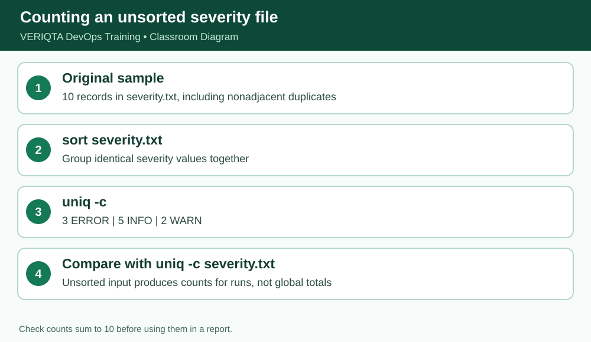

# VERIQTA DevOps Training — Day 004 Notebook
## Stage 4 of 7: Counting with wc

**Level:** Absolute beginner. **System:** Ubuntu/Linux terminal. **Scope:** simulated training files, not production access.

### Learning outcome
Understand **wc** and demonstrate the behavior by running commands and checking actual output.

### Explanation from first principles
`wc -l` counts newline characters (usually log records when each record ends with a newline); `-w` counts whitespace-separated words; `-c` counts bytes. Piping `grep` into `wc -l` counts matching lines, not all instances of a word within a line.

### Before you begin
```bash
cd ~/devops-training/01-linux/day-004
pwd
```
Ensure the sample files have been created using `setup/prepare-practice-files.sh` or the exact here-documents in `notes/complete-lesson.md`.

### Follow-along commands (run one at a time)
```bash
wc -l application.log
```
```bash
wc -w application.log
```
```bash
wc -c application.log
```
```bash
grep "ERROR" application.log | wc -l
```

### Expected observation and verification
The log has ten newline-terminated lines; ERROR count is 3. Word and byte counts depend on exact sample text.

### Why this matters in a production investigation
When debugging a failure, use commands that let you inspect and summarize evidence reproducibly without editing original logs. Verify your working directory, file paths and line counts before drawing conclusions.

### Practical exercises
1. Explain the command in plain English without reading the solution.
2. Predict its output before running it, then compare the actual result.
3. Explain which file, if any, the command changes.
4. Record any unexpected output and the command you used to investigate it.

### Checkpoint before continuing
- [ ] Commands executed from the expected directory
- [ ] Output matches the expected observations
- [ ] Original source file remains intact
- [ ] Can explain the command without memorizing syntax alone

**Evidence instruction:** Capture your own screenshot if learning interactively. No fabricated screenshot is included in this public package.


## Instructor deep dive — wc, sort, uniq and the adjacent-duplicate trap

wc -l counts newline-terminated lines. sort rearranges lines on standard output without changing its input. uniq counts or removes ADJACENT duplicate lines only; therefore sort first when counting all occurrences in an unsorted file. uniq -c adds a count column.



### Demonstrate the commands individually

Run these one by one, **not as a pasted block**, and inspect the result after each command:

```bash
wc -l application.log
sort severity.txt
uniq -c severity.txt
sort severity.txt | uniq -c
```

**Interpretation:** Expected counts for the classroom severity.txt: 3 ERROR, 5 INFO, 2 WARN. The unsorted uniq result is not a reliable overall frequency table.

### Self-explanation checkpoint

Before continuing, explain (1) the command's input, (2) what it writes to standard output, (3) whether it changes any file, and (4) how to recognize incorrect output. If your result differs, confirm `pwd`, `ls -l`, spelling and case, then repeat safely.

### Practice without copying

Reproduce the demonstration from memory, then check your output. Predict what would change if the source file gained another `ERROR` line; distinguish an observation from a hypothesis.
