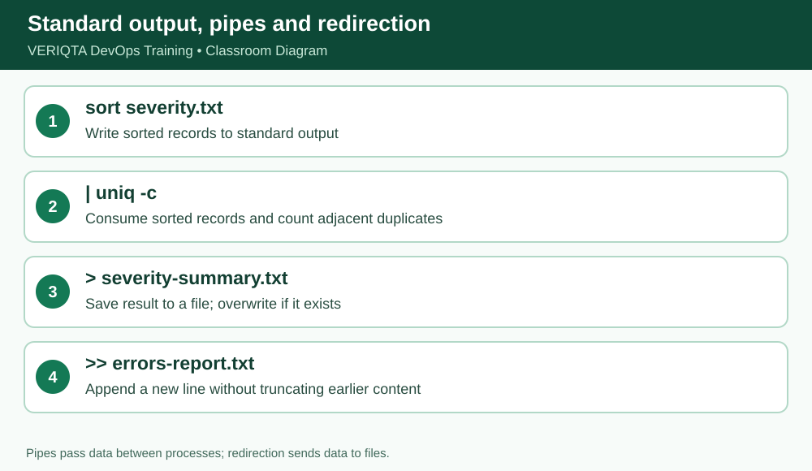

# VERIQTA DevOps Training — Day 004 Notebook
## Stage 6 of 7: Pipes, redirection and reports

**Level:** Absolute beginner. **System:** Ubuntu/Linux terminal. **Scope:** simulated training files, not production access.

### Learning outcome
Understand **| > >>** and demonstrate the behavior by running commands and checking actual output.

### Explanation from first principles
A pipe `|` sends the standard output of one command into the next command. `>` writes a new output file, replacing it if present. `>>` appends. Source files are not modified when you redirect *to a different path*. Always inspect the destination name before Enter; never overwrite preserved evidence.

### Before you begin
```bash
cd ~/devops-training/01-linux/day-004
pwd
```
Ensure the sample files have been created using `setup/prepare-practice-files.sh` or the exact here-documents in `notes/complete-lesson.md`.

### Follow-along commands (run one at a time)
```bash
grep "ERROR" application.log | wc -l
```
```bash
grep -i "ERROR" application.log > errors-report.txt
```
```bash
cat errors-report.txt
```
```bash
ls -l errors-report.txt
```
```bash
echo "Investigation note: three ERROR records identified." >> errors-report.txt
```
```bash
cat errors-report.txt
```

### Expected observation and verification
The report contains three matching ERROR log lines followed by the investigation note; application.log remains ten lines.

### Why this matters in a production investigation
When debugging a failure, use commands that let you inspect and summarize evidence reproducibly without editing original logs. Verify your working directory, file paths and line counts before drawing conclusions.

### Practical exercises
1. Explain the command in plain English without reading the solution.
2. Predict its output before running it, then compare the actual result.
3. Explain which file, if any, the command changes.
4. Record any unexpected output and the command you used to investigate it.

### Checkpoint before continuing
- [ ] Commands executed from the expected directory
- [ ] Output matches the expected observations
- [ ] Original source file remains intact
- [ ] Can explain the command without memorizing syntax alone

**Evidence instruction:** Capture your own screenshot if learning interactively. No fabricated screenshot is included in this public package.


## Instructor deep dive — combine inspection and reporting

Start with file existence and size, then count records, search for errors, inspect surrounding context, and save only justified observations. cut selects delimited fields and awk is a record-oriented text processor; both are useful, but timestamp fields with spaces need thoughtful parsing.



### Demonstrate the commands individually

Run these one by one, **not as a pasted block**, and inspect the result after each command:

```bash
pwd
ls -lh application.log
wc -l application.log
grep -n -E "WARN|ERROR" application.log
head -n 3 application.log
tail -n 3 application.log
```

**Interpretation:** Do not call a single failed request a confirmed complete outage; report exactly what the sample logs show.

### Self-explanation checkpoint

Before continuing, explain (1) the command's input, (2) what it writes to standard output, (3) whether it changes any file, and (4) how to recognize incorrect output. If your result differs, confirm `pwd`, `ls -l`, spelling and case, then repeat safely.

### Practice without copying

Reproduce the demonstration from memory, then check your output. Predict what would change if the source file gained another `ERROR` line; distinguish an observation from a hypothesis.
