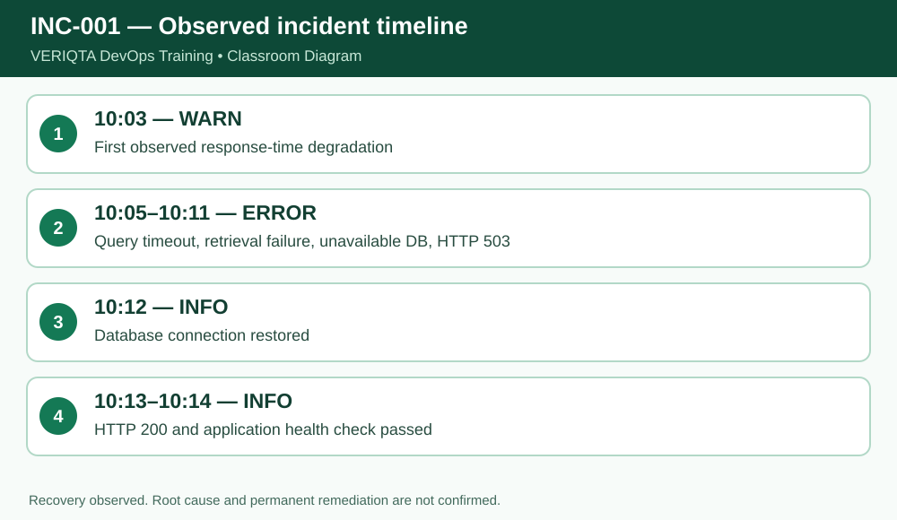

# VERIQTA DevOps Training — Day 004 Notebook
## Stage 7 of 7: Independent production incident investigation

**Level:** Absolute beginner. **System:** Ubuntu/Linux terminal. **Scope:** simulated training files, not production access.

### Learning outcome
Understand **project** and demonstrate the behavior by running commands and checking actual output.

### Explanation from first principles
Use the full case study in `project/README.md` and `project/incident-investigation-workbook.md`. The project begins with directories and a fifteen-line synthetic log, then walks through analysis, seven-section incident reporting, evidence copying, byte comparison, SHA-256 hashes, checksum manifest, and final directory verification. Keep observed facts separate from plausible explanations.

### Before you begin
```bash
cd ~/devops-training/01-linux/day-004
pwd
```
Ensure the sample files have been created using `setup/prepare-practice-files.sh` or the exact here-documents in `notes/complete-lesson.md`.

### Follow-along commands (run one at a time)
```bash
cd project/incident-001
```
```bash
tree
```
```bash
sha256sum -c evidence/SHA256SUMS
```

### Expected observation and verification
Final case tree contains four directories and four files; checksum verification prints OK.

### Why this matters in a production investigation
When debugging a failure, use commands that let you inspect and summarize evidence reproducibly without editing original logs. Verify your working directory, file paths and line counts before drawing conclusions.

### Practical exercises
1. Explain the command in plain English without reading the solution.
2. Predict its output before running it, then compare the actual result.
3. Explain which file, if any, the command changes.
4. Record any unexpected output and the command you used to investigate it.

### Checkpoint before continuing
- [ ] Commands executed from the expected directory
- [ ] Output matches the expected observations
- [ ] Original source file remains intact
- [ ] Can explain the command without memorizing syntax alone

**Evidence instruction:** Capture your own screenshot if learning interactively. No fabricated screenshot is included in this public package.


## Instructor deep dive — investigate, preserve and report

The 15-line synthetic case demonstrates onset analysis, a timeline, cautious impact statements, a seven-section report, an unchanged evidence copy, SHA-256 hashes and checksum verification. A matching hash demonstrates byte equality at check time; it does not independently prove the source was authentic or establish a chain of custody.



### Demonstrate the commands individually

Run these one by one, **not as a pasted block**, and inspect the result after each command:

```bash
cd project/incident-001
wc -l logs/production.log
grep -n -E "WARN|ERROR" logs/production.log
sha256sum -c evidence/SHA256SUMS
```

**Interpretation:** The correct event totals are three WARN and four ERROR (seven combined). The observed recovery does not prove permanent remediation.

### Self-explanation checkpoint

Before continuing, explain (1) the command's input, (2) what it writes to standard output, (3) whether it changes any file, and (4) how to recognize incorrect output. If your result differs, confirm `pwd`, `ls -l`, spelling and case, then repeat safely.

### Practice without copying

Reproduce the demonstration from memory, then check your output. Predict what would change if the source file gained another `ERROR` line; distinguish an observation from a hypothesis.
